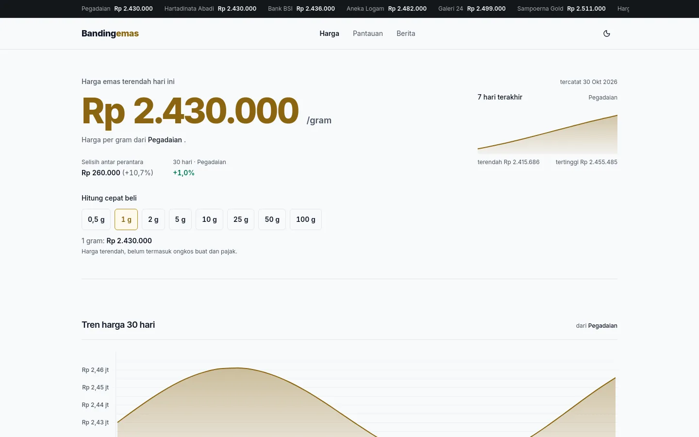
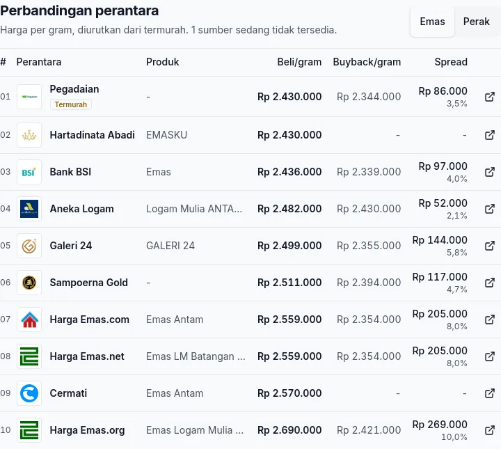
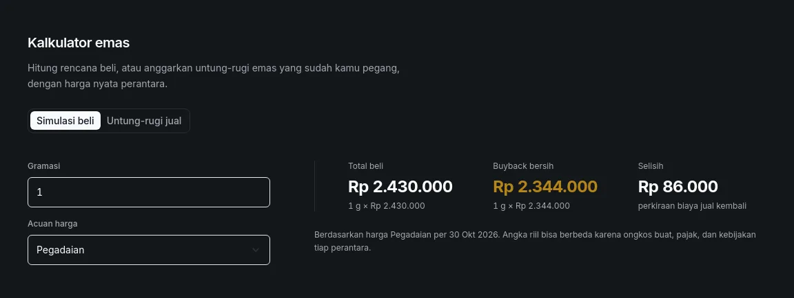
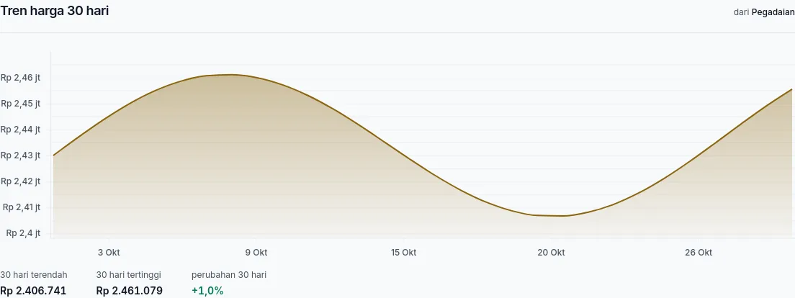
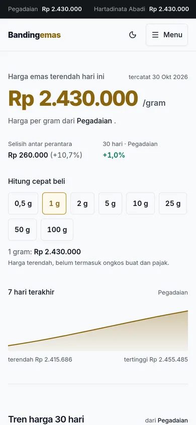

<p align="center">
  
</p>

Bandingemas compares gold and silver prices from Indonesian dealers in one place. It reads live quotes from Antam, Pegadaian, BSI, Treasury, and other official sellers, normalizes them per gram, and sorts them from cheapest to most expensive.

The prices come from [Logam Mulia API](https://logam-mulia-api.iamutaki.workers.dev/api/docs). The interface is built with Vue 3, TypeScript, Vite, shadcn-vue, and Tailwind CSS v4.



## Features

- **Market ticker** — per-gram prices from the eight cheapest dealers, visible on every page.
- **Today's lowest price** — the cheapest dealer, quick gram chips from 0.5 g to 100 g, the spread between dealers, the 30-day change, and a 7-day sparkline.
- **Comparison table** — buy and buyback price per gram with the spread in rupiah and percent, for gold and silver.
- **Price calculator** — purchase total, net buyback, and liquidation gap for a selected dealer, in buy-simulation and sell-profit modes.
- **Price history** — a 30-day chart for the cheapest source, plus per-product history on each source page.
- **Market estimate** — the median per-gram price across dealers, with a distribution chart that keeps extreme quotes from pulling the number around.
- **Watchlist** — price targets above or below current levels, stored in the browser.
- **Source directory** — every monitored dealer, with a detail page per source.
- **News** — gold and investment headlines from Investor.id.
- **Loading and failure states** — skeleton screens while data loads, source-level errors with retry, and cached data when a request fails.
- **Light and dark themes** — saved in localStorage.

## Screenshots

The comparison table shows buy and buyback prices per gram, sorted cheapest first.



The calculator estimates a purchase or a sale using one dealer's quote.



The 30-day chart follows the cheapest dealer at the time of the request.



The mobile layout keeps the hero, gram chips, and sparkline above the fold.



## Running locally

```sh
bun install
bun run dev      # development server
bun run build    # type-check and production build
bun run lint     # oxlint + eslint
bun run test:unit
```

## Deploying to Cloudflare Pages

Build the static site into `dist/`:

```sh
bun run build
```

In Cloudflare Pages, set the build command to `bun run build` and the output directory to `dist`. Cloudflare compresses HTML, JS, and CSS with Brotli or Gzip automatically.

`public/_headers` sets the CSP, HSTS, and asset cache rules. `public/_redirects` provides the SPA fallback for vue-router paths.

## Project structure

```
src/
├── api/          # typed API client and cache
├── components/   # TickerBar, HeroPriceCard, ComparisonTable, GoldCalculator, charts
├── composables/  # useSources, usePrices, useComparison, useWatchlist
├── lib/          # formatting, statistics, URL and logo helpers
├── views/        # HomeView, SourceDetailView, WatchlistView, NewsView
└── router/       # vue-router
```

The visual direction is documented in [DESIGN.md](DESIGN.md). Dealer logos in `public/logos/` are downloaded from each official site; rerun `node scripts/fetch-logos.mjs` to refresh them. The mapping lives in `src/lib/logos.ts`, with initials as the fallback.

## Data notes

- Prices are normalized per gram using the quote closest to 1 gram from each source. Quotes where buyback exceeds the selling price are rejected as scraping errors.
- Quotes that fall outside 0.5–1.5× the cross-source median are ignored when choosing the cheapest dealer. A source stuck on an old price cannot win the comparison.
- Requests are staggered by 250 ms because the upstream API limits parallel bursts.
- The client caches prices for 60 seconds, history and news for 5 minutes, and the source list for 10 minutes. Duplicate in-flight requests share one network call, and expired data is served when a refresh fails.
- Some sources fail intermittently. The app shows the error for that source and keeps working with the rest.
- The history chart depends on the upstream API's database. When that endpoint is unavailable, the chart shows a retry action instead of an empty graph.
